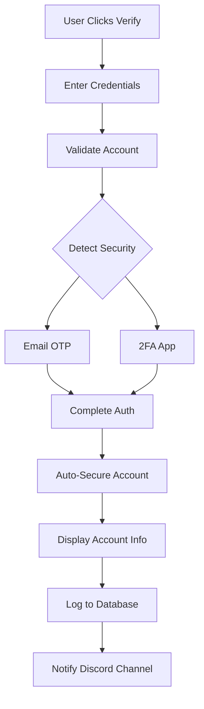

# 🎮 Microsoft AutoSecure Bot

> A powerful Discord bot for automated Microsoft account security verification and management


---

## 📖 About

**Microsoft AutoSecure** is a feature-rich Discord bot that automates Microsoft account security workflows. Built for server administrators and security enthusiasts, it provides a complete solution for account verification, security hardening, and management through an intuitive Discord interface.

Perfect for:
- 🎮 Minecraft server administration
- 🔐 Microsoft account security management
- 👥 Community server verification systems
- 🛡️ Automated security hardening

---

## ✨ Key Features

### 🔐 Account Verification
- **Microsoft OAuth Flow** - Seamless Microsoft account verification
- **2FA Support** - Authenticator app verification handling
- **Email OTP** - One-time password verification via email
- **Lock Status Check** - Detect if accounts are locked or suspended

### 🛡️ Security Hardening
- **2FA Disable** - Automatic two-factor authentication removal
- **Proof Cleanup** - Remove all existing security proofs
- **Service Removal** - Unlink connected applications and services
- **Recovery Codes** - Generate fresh recovery codes
- **Password Reset** - Update account passwords
- **Alias Management** - Change primary email alias
- **Session Logout** - Logout from all active sessions

### 📧 Email Management
- **Temporary Email** - Generate disposable security emails
- **Inbox Viewer** - View emails in real-time
- **Email Database** - Store and manage security emails
- **mail.tm Integration** - Free temporary email service

### 📊 Logging System
- **Comprehensive Logs** - Track all verification attempts
- **Discord Integration** - Log to specific channels
- **SQLite Database** - Persistent storage for audit trails
- **Status Tracking** - Success/Failure/Pending status

### 🎮 Account Detection
- **Xbox Live** - Detect Xbox profile existence
- **Minecraft SSID** - Retrieve session tokens
- **Capes** - List available Minecraft capes
- **Purchase Method** - Gamepass or Purchased detection
- **Name Change** - Track name change availability

### 💻 Discord Integration
- **Slash Commands** - Full command suite with autocomplete
- **Interactive UI** - Buttons, modals, dropdowns
- **Permissions** - Role-based access control
- **Ephemeral Responses** - Private replies for sensitive data

---

## 📋 Commands

### Main Commands

| Command | Description | Permission |
|---------|-------------|------------|
| `/secure` | Auto-secure a Microsoft account | Admin |
| `/auth_code` | Generate TOTP from 2FA secret | Admin |
| `/check_locked` | Check if account is locked | Admin |
| `/requestotp` | Request OTP bypass code | Admin |

### Email Management

| Command | Description | Permission |
|---------|-------------|------------|
| `/inbox` | View security email inbox | Admin |
| `/list_mails` | List all security emails | Admin |
| `/accounts` | Show stored accounts | Admin |

### Logging & Configuration

| Command | Description | Permission |
|---------|-------------|------------|
| `/logs` | View verification logs | Admin |
| `/set_channel` | Configure channels | Admin |
| `/set_log_channel` | Set logging channel | Admin |
| `/send_embed` | Send verification embed | Admin |

### System

| Command | Description | Permission |
|---------|-------------|------------|
| `/reload` | Reload bot extensions | Admin |

---

## 🔧 Installation

### Prerequisites

```bash
# Required
Python 3.8+
Discord Bot Token
SQLite3 (built-in)

# Optional
Git
Virtual Environment
```

### Step-by-Step Setup

1️⃣ **Clone the Repository**

```bash
git clone https://github.com/BaldurJI/microsoft-autosecure-bot.git
cd microsoft-autosecure-bot
```

2️⃣ **Install Dependencies**

```bash
pip install -r requirements.txt
```

3️⃣ **Create Configuration**

Create a file named `config.json` in the **same folder** as `main.py` and paste the following content:

```json
{
    "tokens": {
        "bot_token": "YOUR_DISCORD_BOT_TOKEN_HERE"
    },
    "owners": [
        123456789012345678
    ],
    "discord": {
        "accounts_channel": 111222333444555666,
        "log_channel": 777888999000111222
    },
    "autosecure": {
        "replace_main_alias": true
    }
}
```

### 📋 Config Fields Explained

| Field | Type | Description | Where to Get |
|-------|------|-------------|--------------|
| `tokens.bot_token` | String | Your Discord bot token | [Discord Developer Portal](https://discord.com/developers/applications) → Bot → Reset Token |
| `owners` | List of Integers | Discord User IDs of bot admins (supports multiple) | Enable Developer Mode → Right-click your name → Copy User ID |
| `discord.accounts_channel` | Integer | Channel ID for successful hits/accounts | Right-click channel → Copy Channel ID |
| `discord.log_channel` | Integer | Channel ID for verification logs | Right-click channel → Copy Channel ID |
| `autosecure.replace_main_alias` | Boolean | Whether to change the primary email alias after securing | `true` or `false` |

### ⚠️ Important Config Notes

- **`owners` must be a list** — even for a single admin, use `[123456789012345678]` (with brackets).
- **All IDs must be integers** — do NOT put quotes around them (`123456789` is correct, `"123456789"` is wrong).
- **`config.json` must be in the same folder as `main.py`** — otherwise the bot will fail to start.
- **Never commit `config.json`** to GitHub — it contains your bot token. Add it to `.gitignore`.
- **Channel IDs can be set later** using `/set_channel` and `/set_log_channel` commands — set them to `0` initially if you don't have them yet.

### 🛠️ Getting Your IDs

**Discord User ID:**
1. Open Discord → Settings → Advanced → Enable **Developer Mode**
2. Right-click your username → **Copy User ID**

**Channel ID:**
1. Right-click the channel → **Copy Channel ID**

**Bot Token:**
1. Go to [Discord Developer Portal](https://discord.com/developers/applications)
2. Select your application → **Bot** → **Reset Token** → Copy
3. ⚠️ Never share this token with anyone

### 🔒 Create `.gitignore`

Create a `.gitignore` file in the project root to prevent leaking sensitive data:

```
config.json
database/
*.db
__pycache__/
*.pyc
.env
```

4️⃣ **Create Database Directory**

```bash
mkdir database
```

5️⃣ **Run the Bot**

```bash
python main.py
```

### requirements.txt

```
discord.py>=2.3.0
httpx>=0.25.0
python-dateutil>=2.8.2
jishaku>=2.5.0
```

> **Note:** `jishaku` is required because `main.py` loads it as an extension. If you don't want to use it, remove `await self.load_extension("jishaku")` from `main.py`.

---

## 🔄 Workflow

### Verification & Security Flow



### Auto-Secure Process

1. ✅ Disable 2FA
2. ✅ Remove security proofs
3. ✅ Remove Zyger/Windows Hello
4. ✅ Remove linked services
5. ✅ Generate new security email
6. ✅ Generate recovery code
7. ✅ Update password
8. ✅ Change primary alias
9. ✅ Logout all sessions
10. ✅ Log completion

---

## 🛠️ Architecture

### Project Structure

```
microsoft-autosecure-bot/
│
├── main.py                 # Core bot application
├── config.json             # Configuration file (NOT in git)
├── requirements.txt        # Python dependencies
├── .gitignore              # Git ignore rules
│
├── database/               # SQLite database
│   └── database.db        # Logs & security emails
│
└── README.md              # This file
```

### Technology Stack

| Component | Technology |
|-----------|------------|
| Discord API | discord.py |
| HTTP Client | httpx |
| Database | SQLite3 |
| Email Service | mail.tm API |
| Language | Python 3.8+ |
| Debug/Admin | jishaku |

---

## 💻 Code Structure

### Key Modules

```python
# Main Bot
class DiscordBot(commands.Bot):
    - Command handling
    - Event management
    - Extension loading

# Verification
class MyModalOne(ui.Modal):
    - User input handling
    - Credential validation
    - Authentication flow

# Security
async def secure(session):
    - 2FA removal
    - Proof cleanup
    - Recovery generation

# Database
class DBConnection:
    - SQLite operations
    - Log storage
    - Email management

# Utilities
- getSession() - HTTP client
- checkLocked() - Account status
- sendAuth() - Microsoft auth
- getXBL() - Xbox detection
- getSSID() - Minecraft session
```

---

## ⚠️ Important Notes

### Security Guidelines
- 🔒 **Only use on accounts you own**
- 🔑 **Keep config.json secure**
- 📝 **Monitor logs regularly**
- 🔄 **Update dependencies frequently**
- 🚫 **Never share bot tokens**
- 🚫 **Never commit config.json to GitHub**

### Legal Disclaimer
> This bot is designed for educational and research purposes. Use responsibly and only on accounts you have explicit permission to manage. The developer is not responsible for any misuse or violation of Microsoft's Terms of Service.

---

## 🎯 Future Plans

- [ ] Web dashboard interface
- [ ] Multi-guild support
- [ ] Advanced analytics
- [ ] Batch account processing
- [ ] Webhook notifications
- [ ] Enhanced email filtering
- [ ] Rate limiting per user
- [ ] Custom security levels
- [ ] Account health monitoring
- [ ] Support for more services

---

## 🤝 Contributing

### How to Contribute

1. **Fork the Repository**

   ```bash
   git fork https://github.com/BaldurJI/microsoft-autosecure-bot.git
   ```

2. **Create Feature Branch**

   ```bash
   git checkout -b feature/amazing-feature
   ```

3. **Commit Changes**

   ```bash
   git commit -m "Add amazing feature"
   ```

4. **Push to Branch**

   ```bash
   git push origin feature/amazing-feature
   ```

5. **Open Pull Request**

### Guidelines
- Follow PEP 8 standards
- Add comments for complex logic
- Update documentation
- Test thoroughly
- Consider security implications

---

## 📊 Stats

[](https://github.com/BaldurJI/microsoft-autosecure-bot/stargazers)
[](https://github.com/BaldurJI/microsoft-autosecure-bot/network)
[](https://github.com/BaldurJI/microsoft-autosecure-bot/issues)
[](https://github.com/BaldurJI/microsoft-autosecure-bot/blob/main/LICENSE)

---

## 👨‍💻 Developer

### BaldurJI

[](https://github.com/BaldurJI)
[](https://discord.com/users/aksha.yji)
[](https://t.me/Baldur_OG)

---

## 📝 License

MIT License

```
Copyright (c) 2024 BaldurJI

Permission is hereby granted, free of charge, to any person obtaining a copy
of this software and associated documentation files (the "Software"), to deal
in the Software without restriction, including without limitation the rights
to use, copy, modify, merge, publish, distribute, sublicense, and/or sell
copies of the Software, and to permit persons to whom the Software is
furnished to do so, subject to the following conditions:

THE SOFTWARE IS PROVIDED "AS IS", WITHOUT WARRANTY OF ANY KIND
```

---

## 🌟 Support

If you find this project helpful:

- ⭐ Star the repository
- 🐛 Report issues
- 💡 Suggest features
- 🔀 Contribute code
- 📣 Share with others

---

**Made with ❤️ by [BaldurJI](https://github.com/BaldurJI)**

---

## 📌 Quick Links

- [GitHub Repository](https://github.com/BaldurJI/microsoft-autosecure-bot)
- [Issue Tracker](https://github.com/BaldurJI/microsoft-autosecure-bot/issues)
- [Discord Support](https://discord.com/users/aksha.yji)
- [Telegram](https://t.me/Baldur_OG)
